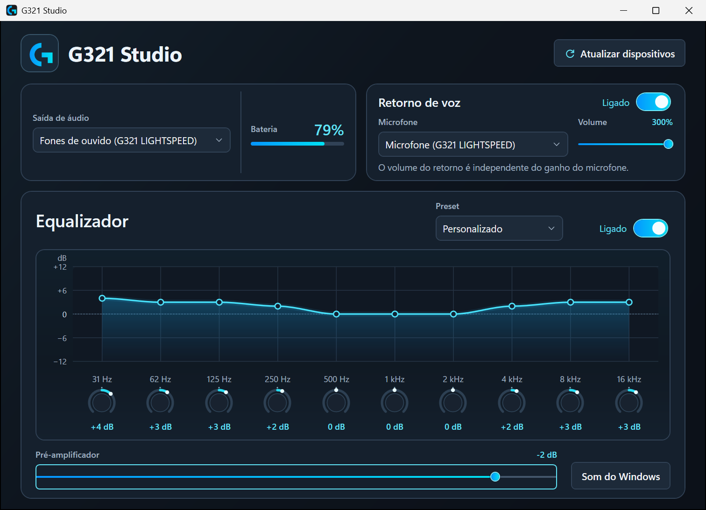

# G321 Studio

Aplicativo independente e não oficial para uso com o headset Logitech G G321 LIGHTSPEED. Oferece equalizador de 10 bandas com presets, retorno de voz com volume ajustável e leitura da porcentagem de bateria. O projeto é mantido sem afiliação, patrocínio ou endosso da Logitech. [Headset compatível](https://www.logitechg.com/pt-br/shop/p/g321.981-001562)

## Download para Windows

[](https://github.com/gleyssonsc/g321-studio/releases/download/v1.0.3/G321-Studio-Setup-1.0.3.exe)

[Política de assinatura de código (Code signing policy)](docs/code-signing-policy.md)

Requer Windows 10 (versão 2004 ou posterior) ou Windows 11. O EXE inclui as versões x64, x86 e ARM64, o ambiente .NET e o instalador oficial do Equalizer APO. [Notas da versão 1.0.3](https://github.com/gleyssonsc/g321-studio/releases/tag/v1.0.3)



*Captura da compilação atual do código-fonte.*

## Configuração rápida do EQ em LIGHTSPEED

1. **Conecte o receptor USB** e ligue o G321 em LIGHTSPEED.
2. **Abra o instalador** na conta do Windows que vai usar o app. Se o Equalizer APO ainda estiver ausente, marque **Instalar o Equalizer APO (requer administrador)** na última tela e conclua a instalação.
3. **Habilite o efeito na saída do G321.** No **Equalizer APO Device Selector**, marque apenas **Fones de ouvido (G321 LIGHTSPEED)** na lista de reprodução. Se o seletor não abrir sozinho, procure-o no menu Iniciar. Reinicie se solicitado.
4. **Selecione o G321 como saída** no Windows ou no jogo. Mantenha os **Aprimoramentos de áudio** habilitados nessa saída.
5. **Abra o G321 Studio pela bandeja.** A chave do **Equalizador** deve indicar **Ligado**, com **Plano** selecionado automaticamente. Escolha **Jogos** ou **Graves** para ouvir a mudança.

## Instalação e ajustes

No instalador 1.0.3, escolha **Português (Brasil)** ou **English**. Essa escolha define o idioma do Setup e do Studio para a conta do Windows usada na instalação. Para mudar de idioma, abra o Setup novamente e selecione a outra opção. O instalador opcional do Equalizer APO oferece inglês e alemão.

Para instalar sem internet, desmarque a procura automática por atualizações no instalador do Equalizer APO. O instalador oficial desativa o modo protegido do mecanismo de áudio do Windows para carregar o efeito. Essa configuração vale para o sistema todo. Depois da autorização, o Setup extrai o instalador do APO em uma pasta temporária protegida e confere seu SHA-256 antes de abri-lo. [Equalizer APO](https://sourceforge.net/projects/equalizerapo/)

Mantenha selecionada a opção **Iniciar o G321 Studio na bandeja ao entrar no Windows** se quiser iniciar o app junto com o Windows. Antes de atualizar ou desinstalar, use **Sair** no menu da bandeja.

Arraste os pontos da curva ou use os controles circulares para ajustar as bandas. Ao editar uma banda ou o pré-amplificador, o app armazena os ajustes em **Personalizado**. O EQ também se aplica ao áudio do retorno de voz nessa saída.

## Retorno de voz

Escolha a saída e o microfone do G321, ligue a chave **Retorno de voz** e ajuste o volume. Em LIGHTSPEED, ambos precisam pertencer ao mesmo receptor USB. A desconexão de um dos dispositivos ou a opção **Sair** na bandeja encerra o retorno.

## Bandeja e ativação automática

O G321 Studio inicia na bandeja do Windows. Para mostrar a janela, clique duas vezes no ícone ou selecione **Abrir G321 Studio** no menu da bandeja. O **X** e o botão de minimizar recolhem a janela. O EQ e o retorno de voz continuam funcionando se estiverem ligados. Para encerrar o aplicativo, use **Sair** no menu da bandeja.

Com o APO configurado, o Studio liga o EQ com o preset **Plano** quando o G321 responde em LIGHTSPEED. Usar a chave do EQ pausa a ativação automática até a próxima abertura do app.

## Bateria

Com o G321 em LIGHTSPEED, o app lê a porcentagem de bateria informada pelo receptor USB. Se essa leitura estiver indisponível e o G321 estiver conectado por Bluetooth, o app procura o nível informado pelo Windows ou pelo serviço Bluetooth de bateria.

A leitura é atualizada automaticamente e pode ser solicitada em **Atualizar dispositivos**. Quando a porcentagem está indisponível, o app exibe um traço.

## Privacidade

O retorno de voz usa o microfone quando você liga a chave correspondente e mantém o áudio em memória para reprodução local. O G321 Studio não grava nem transmite esse áudio. O app guarda as preferências de EQ, o volume do retorno e os identificadores dos dispositivos de áudio selecionados em `%LOCALAPPDATA%\G321 Studio\settings.json`.

Ao relatar um problema, oculte nomes de usuário, caminhos pessoais, números de série e identificadores de dispositivos antes de compartilhar registros, capturas de tela ou diagnósticos.

## Compilar

Use o SDK .NET 10 para gerar o executável x64 em `dist`.

```powershell
dotnet publish -c Release -r win-x64 --self-contained true -p:PublishSingleFile=true -p:IncludeNativeLibrariesForSelfExtract=true -p:EnableCompressionInSingleFile=true -p:DebugType=None -o dist
```

Para gerar o instalador, use PowerShell 7, o SDK .NET 10, o compilador Inno Setup 6.7.3 ou posterior e os quatro arquivos do Equalizer APO 1.4.2. O script confere os arquivos por SHA-256 e gera `dist/G321 Studio Setup.exe`. [Arquivos oficiais do Equalizer APO 1.4.2](https://sourceforge.net/projects/equalizerapo/files/1.4.2/)

```powershell
./installer/Build-OfflineSetup.ps1 -ApoDirectory 'C:\build\EqualizerAPO-1.4.2' -InnoCompiler 'C:\build\InnoSetup\ISCC.exe'
```

O workflow [Build offline Windows installer](https://github.com/gleyssonsc/g321-studio/actions/workflows/build-offline-installer.yml) roda a cada push na branch `main`, em novas tags `v*` ou por execução manual. A execução disponibiliza o EXE e o arquivo `SHA256SUMS.txt` em **Artifacts**. A compilação baixa as dependências no runner. O instalador inclui os arquivos necessários para a instalação offline.

### Assinatura para distribuição no GitHub

O GitHub Actions pode solicitar a assinatura do EXE offline depois da aprovação e da configuração da conta SignPath. Veja a [configuração da assinatura no GitHub Actions](docs/signpath-setup.md).

Para assinar uma release localmente, use o **SignTool** do Windows SDK e um certificado de assinatura de código emitido por uma autoridade confiável. O certificado deve estar disponível com a chave no repositório `CurrentUser\My` do Windows. Tokens e serviços de assinatura podem ser usados quando o provedor disponibiliza o certificado e a chave nesse repositório. Para selecionar um certificado em `LocalMachine\My`, passe também `-CertificateStoreLocation LocalMachine`. [Documentação do SignTool](https://learn.microsoft.com/windows/win32/seccrypto/signtool)

```powershell
$build = @{
    ApoDirectory          = 'C:\build\EqualizerAPO-1.4.2'
    InnoCompiler          = 'C:\build\InnoSetup\ISCC.exe'
    SignToolPath          = 'C:\build\WindowsSDK\signtool.exe'
    CertificateThumbprint = '<impressão digital de 40 dígitos hexadecimais>'
}
./installer/Build-OfflineSetup.ps1 @build
```

O build assina os executáveis do Studio, o Setup e o desinstalador em SHA-256, com carimbo de tempo RFC 3161. Use `-TimestampUrl` se o seu provedor indicar outro servidor. A internet é necessária para obter o carimbo durante o build. A instalação continua offline. O script valida a assinatura e o carimbo antes de substituir o EXE em `dist`.

Teste o arquivo assinado em um Windows limpo e use o SHA-256 exibido ao final do build ao publicar uma nova release. O SmartScreen pode continuar exibindo avisos enquanto o arquivo ou o publicador acumula reputação. [Reputação do SmartScreen](https://learn.microsoft.com/pt-br/windows/apps/package-and-deploy/smartscreen-reputation)

## Licenças e marcas

O código e a documentação originais do G321 Studio usam a [licença MIT](LICENSE). Os componentes de terceiros seguem suas próprias licenças. O ícone e as marcas da Logitech ficam fora da licença MIT.

- O Equalizer APO 1.4.2 é um componente separado, distribuído sob GPLv2. O instalador inclui o arquivo oficial com o código-fonte correspondente, `EqualizerAPO-src-1.4.2.zip`, na pasta **Licenças** da instalação. [Projeto Equalizer APO](https://sourceforge.net/projects/equalizerapo/)
- O NAudio usa a licença MIT. O arquivo de licença está no repositório e também é instalado na pasta **Licenças**, junto com os avisos do .NET e do Windows Desktop. [Licença do NAudio](installer/NAudio-LICENSE.txt)

Logitech, Logitech G e LIGHTSPEED são marcas comerciais ou registradas da Logitech Europe S.A. ou de suas afiliadas nos Estados Unidos ou em outros países. [Diretrizes de marcas da Logitech](https://www.logitech.com/en-us/tos/trademark-guidelines)
